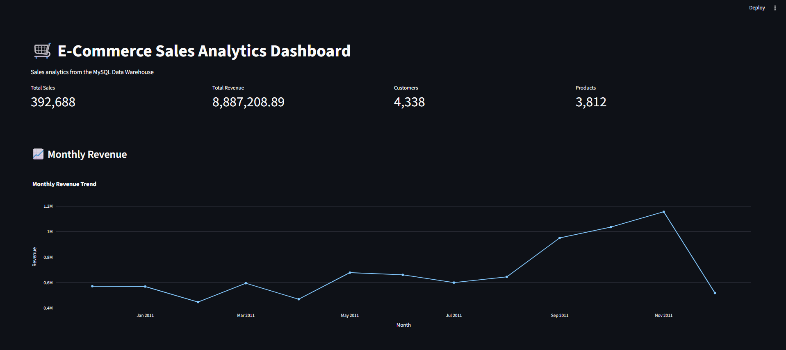
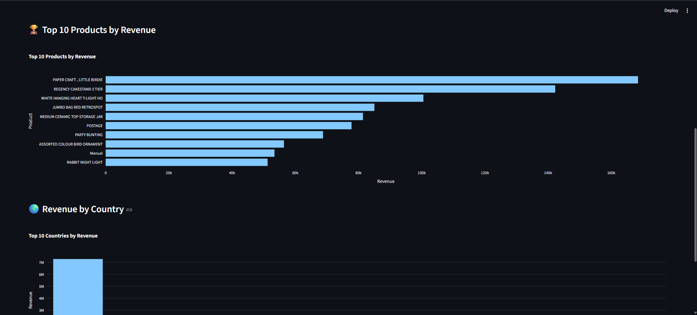
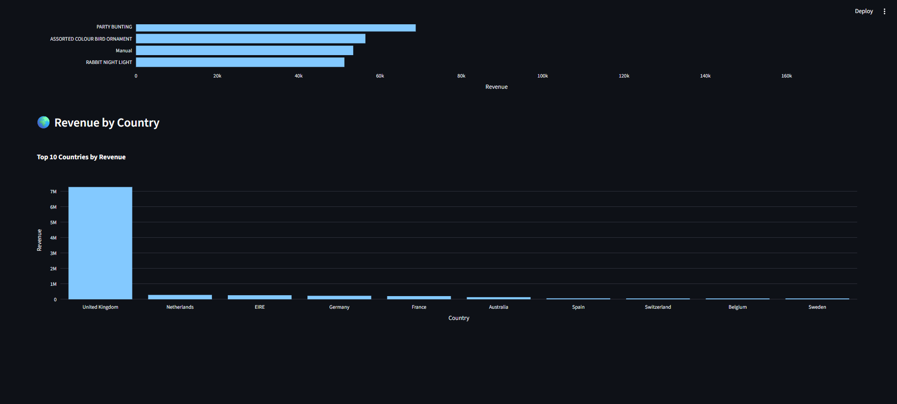

# E-Commerce Sales ETL & SQL Analytics Pipeline

[](https://spark.apache.org/)
[](https://www.docker.com/)
[](https://www.mysql.com/)
[](https://www.python.org/)

An end-to-end data engineering pipeline built using the Online Retail dataset. The pipeline extracts raw retail data, transforms and cleans it using **Apache PySpark**, loads structured data into a **MySQL Data Warehouse** using a Star Schema, performs automated data-quality validations, and provides SQL analytics and interactive visualizations through a Streamlit dashboard.

---

## Architecture Overview

```text
Online Retail Excel Dataset
            |
            v
     Python / OpenPyXL
            |
            v
       Raw CSV Data
            |
            v
   Apache PySpark + Docker
            |
            |-- Handle missing values
            |-- Filter invalid transactions
            |-- Remove duplicates
            |-- Clean text fields
            |-- Calculate Revenue (Quantity x Unit Price)
            |
            v
     Cleaned CSV Data
            |
            v
   MySQL Data Warehouse (Star Schema)
            |
            +-- dim_customer
            +-- dim_product
            +-- dim_date
            +-- fact_sales
            |
            v
  Post-Load Data Quality Validation
            |
            v
       SQL Analytics & Views
            |
            v
     Streamlit Dashboard
```

---

## Key Data Engineering Concepts Demonstrated

- **ETL Pipeline Development:** Batch extraction, transformation, and database loading workflows.
- **Distributed Data Processing:** Apache PySpark DataFrames for data cleaning and feature engineering.
- **Containerization:** Docker and Docker Compose for isolated and reproducible runtime environments.
- **Data Warehousing & Dimensional Modeling:** Star Schema design using fact and dimension tables.
- **Data Quality & Validation:** Automated checks for data integrity, calculation accuracy, and referential integrity.
- **SQL Analytics:** Joins, aggregations, analytical queries, and reusable database views for business intelligence.

---

## Dataset Information

This project uses the **Online Retail** dataset, which contains transactional records from an e-commerce retailer.

The dataset includes the following attributes:

- **InvoiceNo:** Unique invoice number assigned to each transaction.
- **StockCode:** Product/item code.
- **Description:** Product description.
- **Quantity:** Quantity of each product per transaction.
- **InvoiceDate:** Transaction date and time.
- **UnitPrice:** Product price per unit.
- **CustomerID:** Unique identifier assigned to each customer.
- **Country:** Country associated with the customer.

**Dataset source:** [UCI Machine Learning Repository – Online Retail](https://archive.ics.uci.edu/dataset/352/online-retail)

---

## Data Warehouse Design (Star Schema)

The MySQL Data Warehouse is structured using a **Star Schema** to support analytical queries and reporting.

### Fact Table

- **`fact_sales`:** Stores sales transactions, numerical measures, and foreign keys connecting to the dimension tables.
  - `sale_id`
  - `invoice_no`
  - `stock_code`
  - `customer_id`
  - `date_key`
  - `quantity`
  - `unit_price`
  - `revenue`

### Dimension Tables

- **`dim_customer`:** Stores customer information and geographic attributes.
  - `customer_id`
  - `country`

- **`dim_product`:** Stores product details.
  - `stock_code`
  - `description`

- **`dim_date`:** Stores date-related attributes for chronological analysis.
  - `date_key`
  - `year`
  - `month`
  - `day`

The fact table connects to the dimension tables through foreign keys, allowing analytical queries such as monthly revenue, top-performing products, and revenue by country.

---

## Data Quality & Validation

### PySpark Data Cleaning

The transformation stage performs the following operations:

- Handles missing values in required fields.
- Filters invalid transactions with non-positive quantities or unit prices.
- Removes duplicate records.
- Trims and cleans text fields.
- Calculates revenue using:

  `Revenue = Quantity × UnitPrice`

During data cleaning, four zero-price records were identified and filtered out along with other invalid transactions.

### Post-Load Data Quality Checks

After loading the transformed records into MySQL, automated validation checks verify:

- Positive quantities and unit prices.
- Revenue calculation accuracy.
- Referential integrity between fact and dimension tables.
- Consistency of the loaded warehouse data.

These checks help ensure that the transformed data is correctly stored and ready for analytical queries.

---

## Key Metrics & Pipeline Results

| Metric | Result |
|---|---:|
| Valid Sales Records | 392,688 |
| Unique Customers | 4,338 |
| Products in Product Dimension | 3,812 |
| Distinct Products in Sales Transactions | 3,664 |
| Date Granularity | 305 unique days |
| Total Calculated Revenue | Approximately 8.89 million |

These metrics represent the processed dataset loaded into the MySQL Data Warehouse.

---

## Dashboard Preview

The Streamlit dashboard connects to the MySQL Data Warehouse and provides interactive visualizations of key business metrics.

### Dashboard Overview



### Top 10 Products by Revenue



### Revenue by Country



---

## Project Structure

```text
ecommerce-sales-etl-sql-pipeline/
├── data/
│   └── cleaned_retail/          # Processed CSV output (generated locally)
├── screenshots/
│   ├── dashboard-overview.png
│   ├── top-products.png
│   └── revenue-by-country.png
├── sql/
│   ├── schema.sql               # Data warehouse table definitions
│   └── analytics.sql            # Monthly revenue analytical view
├── src/
│   ├── prepare_data.py          # Converts XLSX to CSV
│   ├── transform.py             # PySpark ETL transformations
│   ├── load_to_mysql.py         # Loads data into MySQL
│   └── data_quality.py          # Post-load data validation
├── dashboard.py                 # Streamlit dashboard
├── docker-compose.yml           # MySQL container configuration
├── requirements.txt             # Python dependencies
├── sql_queries.sql              # Analytical SQL queries
├── .gitignore
└── README.md
```

---

## Tech Stack

| Category | Technologies |
|---|---|
| Programming Language | Python 3.x |
| Data Processing | Apache PySpark |
| Excel Parsing | OpenPyXL |
| Database | MySQL 8.0 |
| Database Connector | mysql-connector-python |
| Containerization | Docker, Docker Compose |
| Dashboard | Streamlit, Plotly |
| Version Control | Git, GitHub |

---

## Getting Started

Follow these steps to set up and run the project locally.

### Prerequisites

Make sure you have installed:

- Python 3.8 or later
- Git
- Docker Desktop

### 1. Clone the Repository

```bash
git clone https://github.com/salmasss1510/ecommerce-sales-etl-sql-pipeline.git
cd ecommerce-sales-etl-sql-pipeline
```

### 2. Install Python Dependencies

Create and activate a virtual environment.

**Windows (PowerShell):**

```powershell
python -m venv venv
.\venv\Scripts\Activate.ps1
```

Install the required dependencies:

```bash
pip install -r requirements.txt
```

### 3. Download the Dataset

Download the **Online Retail.xlsx** dataset from the [UCI Machine Learning Repository](https://archive.ics.uci.edu/dataset/352/online-retail).

Create a `data` folder in the project root and place the downloaded Excel file inside it:

```text
data/
└── Online Retail.xlsx
```

The dataset is excluded from GitHub, so each user must download it separately.

### 4. Convert Excel Data to CSV

Run the extraction script:

```bash
python src/prepare_data.py
```

This converts the Excel dataset into `data/online_retail.csv` using OpenPyXL.

### 5. Run PySpark ETL Using Docker

Make sure Docker Desktop is running.

**Windows (PowerShell):**

```powershell
docker run --rm -it -v "${PWD}:/workspace" -w /workspace apache/spark:4.2.0-python3 /opt/spark/bin/spark-submit src/transform.py
```

This performs data cleaning and transformation using PySpark and generates the processed CSV files in `data/cleaned_retail/`.

### 6. Start the MySQL Database

Start the MySQL container using Docker Compose:

```bash
docker compose up -d
```

This starts the MySQL 8.0 service and initializes the `ecommerce_dw` database.

### 7. Create the Data Warehouse Schema

Execute the SQL schema script inside the MySQL container:

```bash
docker exec -i ecommerce-mysql mysql -uroot -proot < sql/schema.sql
```

This creates the customer, product, date, and sales fact tables.

### 8. Load Processed Data into MySQL

Run the data loading script:

```bash
python src/load_to_mysql.py
```

This loads the cleaned records into the MySQL Star Schema data warehouse.

### 9. Run Data Quality Validation

Execute:

```bash
python src/data_quality.py
```

This validates the loaded warehouse data, including quantities, prices, revenue calculations, and referential integrity.

### 10. Create the Monthly Revenue View

Execute the analytics SQL script:

```bash
docker exec -i ecommerce-mysql mysql -uroot -proot ecommerce_dw < sql/analytics.sql
```

This creates the reusable `monthly_revenue` analytical view.

### 11. Launch the Streamlit Dashboard

Run:

```bash
python -m streamlit run dashboard.py
```

Open the local URL displayed in your terminal to explore the interactive sales analytics dashboard.

---

## Future Improvements

- Move database credentials into environment variables for improved security.
- Add incremental data loading to avoid reprocessing the complete dataset.
- Introduce additional data-quality monitoring and logging.
- Optimize analytical queries as the data volume grows.
- Deploy the dashboard and database using a cloud platform.

---

## Author

**Salma Siddique**

Computer Science and Engineering Student

[GitHub](https://github.com/salmasss1510) | [LinkedIn](https://www.linkedin.com/in/salma-siddique-962608320/)